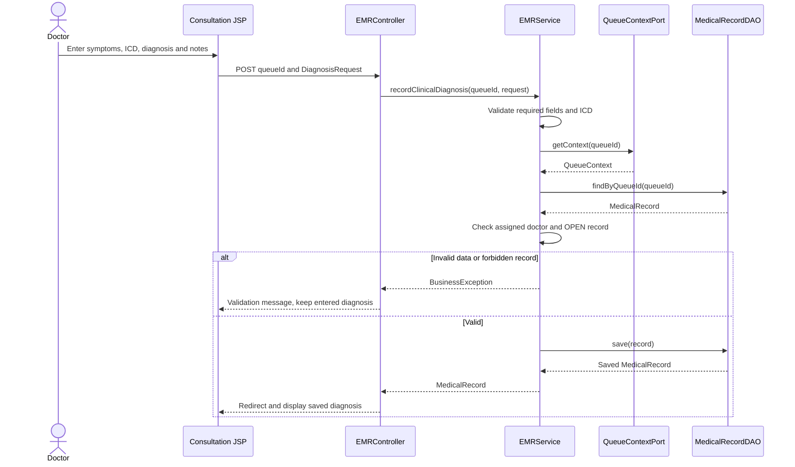
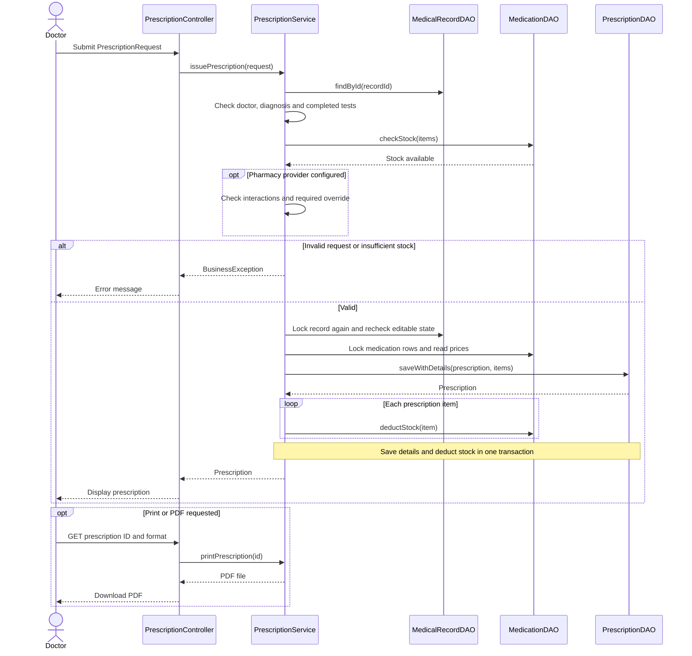
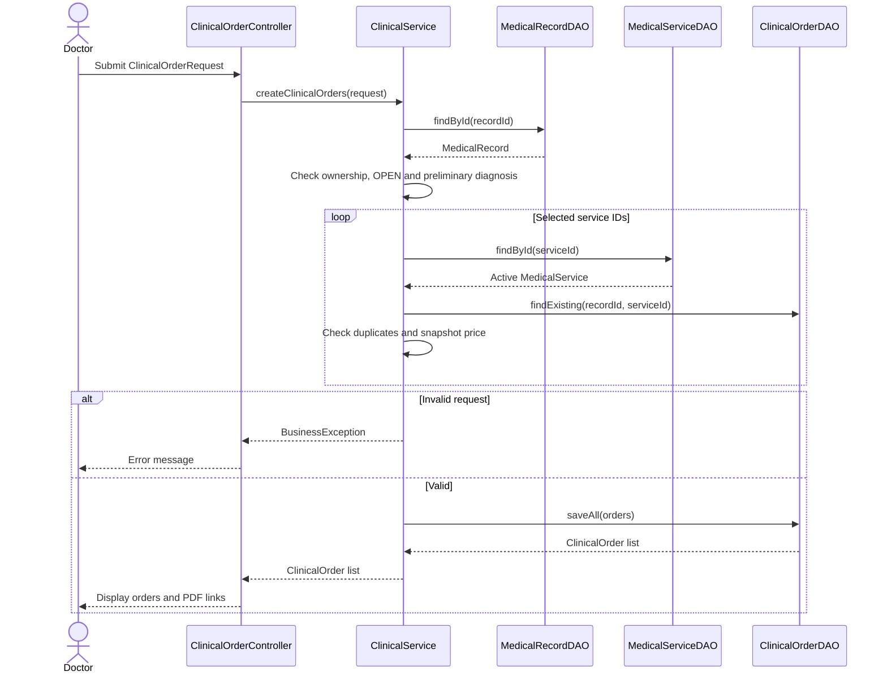
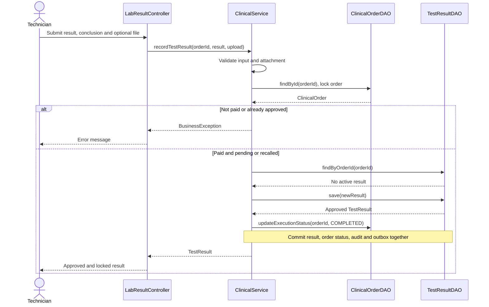
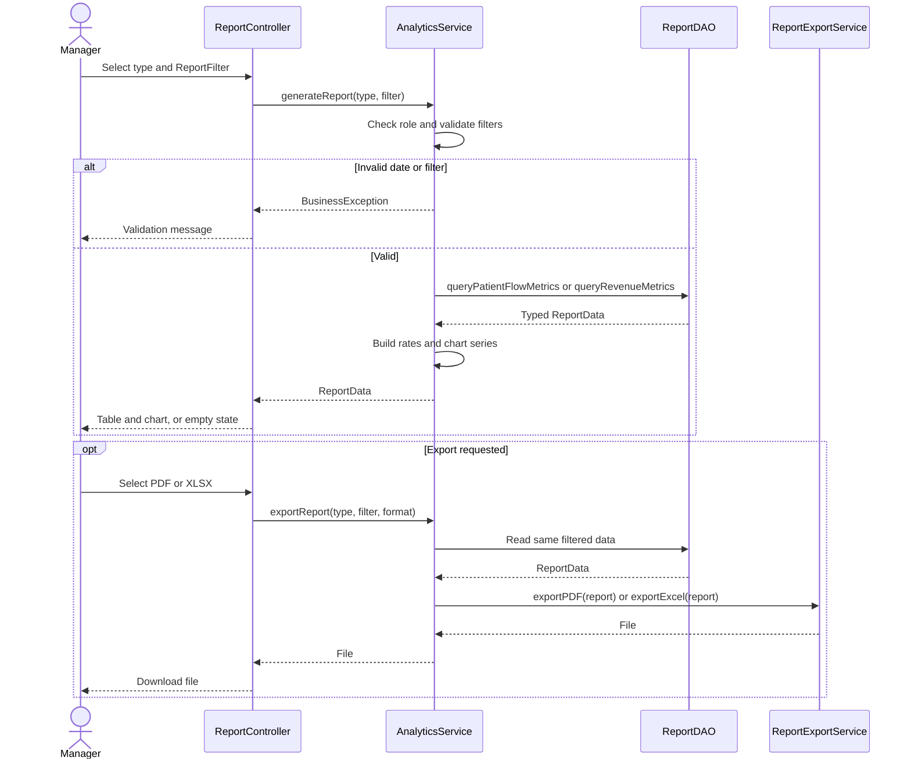

# Hướng dẫn đọc code phần Nam

Bản cập nhật 29/10/2026. Không dùng Spring; vẫn là Servlet/JSP → Service → DAO → MySQL. Comment tiếng Việt tập trung ở quy tắc nghiệp vụ và transaction; getter/setter giữ ngắn.

## Nên đọc theo thứ tự

| Luồng | Controller nhận form | Service xử lý chính | DAO thao tác dữ liệu |
|---|---|---|---|
| SQ16: chẩn đoán | EMRController | EMRService.recordClinicalDiagnosis | MedicalRecordDAO |
| SQ17: kê đơn | PrescriptionController | PrescriptionService.validatePrescription / issuePrescription | MedicationDAO, PrescriptionDAO |
| SQ18: chỉ định/hủy | ClinicalOrderController | ClinicalService.createClinicalOrders / cancelOrder, BillingService.removeUnpaidClinicalCharge | ClinicalOrderDAO, InvoiceDAO, PaymentAttemptDAO |
| SQ19: duyệt kết quả | LabResultController | ClinicalService.recordTestResult | ClinicalOrderDAO, TestResultDAO |
| Bổ sung: thu hồi | ResultRecallController | ResultRecallService.requestRecall / reviewRequest | ResultRecallDAO, TestResultDAO |
| SQ20: báo cáo | ReportController | AnalyticsService.generateReport / exportReport | ReportDAO |
| Tác vụ nền | BackgroundJobs | MaintenanceService → ReportBatchService | ReportSummaryDAO |
| Thông báo bác sĩ | ClinicalUpdateController | ClinicalUpdateService | ClinicalUpdateDAO |

## 1. Hủy chỉ định đã lên hóa đơn nhưng chưa trả

Đọc `ClinicalService.cancelOrder` rồi `BillingService.removeUnpaidClinicalCharge`.

1. Kiểm tra bác sĩ phụ trách và bệnh án còn mở.
2. Khóa bản ghi theo thứ tự bệnh án → hóa đơn → chỉ định. Thứ tự này tránh chồng chéo với thu ngân đang thanh toán.
3. Chỉ hủy chỉ định chưa thực hiện và chưa thanh toán.
4. Có giao dịch VNPay còn trong 15 phút thì báo chờ xử lý, giữ nguyên chỉ định và hóa đơn.
5. Giao dịch VNPay cũ hết hạn chuyển EXPIRED; callback của nó không được tự thanh toán hóa đơn đã đổi số tiền.
6. Xóa đúng dòng phí ORDER của hóa đơn chưa trả, tính tổng lại. Hóa đơn không còn dòng phí chuyển CANCELLED.
7. Chuyển chỉ định CANCELLED và ghi audit.

Tất cả nằm trong `Database.tx`: lỗi ở bất kỳ bước nào sẽ rollback. Không xóa dòng của hóa đơn PAID.

## 2. Tiến trình khám và trạng thái khóa

`ClinicalProgress.from(record, orders)` dùng câu lệnh if và vòng for để suy ra tiến trình:

- Chưa có chẩn đoán: NOT_DIAGNOSED.
- Có chẩn đoán, không còn xét nghiệm cần làm: EXAMINED.
- Có chỉ định chưa hoàn tất hoặc kết quả bị thu hồi: WAITING_TESTS.
- Có xét nghiệm và tất cả chỉ định còn hiệu lực đã hoàn tất: RESULTS_READY.
- Bệnh án CLOSED, không có kết quả đang thu hồi: FINISHED.

`MedicalRecord.status` vẫn OPEN/CLOSED để kiểm soát quyền sửa. Tiến trình là dữ liệu hiển thị suy ra, không thêm một cột trùng trạng thái vào ERD. Khi kết quả của lượt đã đóng bị thu hồi, chẩn đoán cũ không tự mở khóa; bác sĩ nhận cảnh báo và xem xét xử lý chuyên môn/lượt tái khám.

## 3. Thu hồi kết quả có phê duyệt

Kỹ thuật viên hoặc bác sĩ phụ trách gửi lý do. Trưởng khoa chỉ thấy và duyệt dịch vụ thuộc chuyên khoa của mình; Manager/Admin không mặc nhiên có quyền trưởng khoa.

- Đề nghị PENDING → APPROVED hoặc REJECTED.
- Phê duyệt cần ý kiến và biên bản PDF tối đa 5 MB.
- Biên bản do trưởng khoa upload. Phần mềm lưu người phê duyệt, thời gian và tệp; **không xác minh chữ ký số/PKI hoặc tự nhận diện chữ ký trong PDF**.
- Phê duyệt đặt kết quả cũ RECALLED và `approved=false`, chỉ định RESULT_RECALLED.
- Kỹ thuật viên nhập bản thay thế: tạo TestResult có ID mới, giữ nguyên toàn bộ nội dung và tệp bản gốc. Mỗi chỉ định chỉ có tối đa một TestResult APPROVED.
- Bác sĩ/bệnh nhân chỉ tải kết quả đang có hiệu lực. Trưởng khoa có thể tra cứu tệp cũ và biên bản qua phiếu thuộc khoa của mình.
- Tải biên bản/tệp gốc không xóa file. `BaseController.download` chỉ dành cho file xuất tạm (đơn thuốc, báo cáo); controller thu hồi stream tệp lưu lâu dài bằng hàm riêng.

Tài khoản demo: `head@hospital.test`, mật khẩu `Demo@1234`, phụ trách khoa Nội. Tài khoản được thêm bằng script demo riêng, không đưa thông tin này vào database thực.

## 4. Thông báo và báo cáo nền

`ClinicalUpdateDAO` chỉ đọc sự kiện APPROVE_RESULT/RECALL_RESULT thuộc bệnh nhân của bác sĩ đăng nhập. JavaScript kiểm tra mỗi 15 giây, hiện liên kết mở bệnh án; không reload form đang nhập. Tab ẩn hoặc không thao tác hơn 10 phút sẽ tạm dừng kiểm tra. Đây là polling, không phải WebSocket.

`ReportBatchService` tổng hợp ngày trước vào `report_daily_summary` sau nửa đêm (múi giờ Việt Nam), hoặc khi ứng dụng khởi động lại. Chạy lại cập nhật cùng một dòng, không cộng lặp. Màn hình vẫn dùng ReportDAO đọc số liệu thời gian thực; tác vụ nền không làm thay đổi bệnh án/hóa đơn.

## 5. Cài database

Database đã có schema SDS-aligned: sao lưu, chạy **05-nam-workflows.sql một lần** bằng tài khoản có quyền ALTER/CREATE. Script giữ các TestResult cũ và thêm UNIQUE cho kết quả đang có hiệu lực. Không chạy lại schema/seed trên dữ liệu đã có.

Database mới: **01-schema → 04-operational-extensions → 02-seed → 05-nam-workflows**. `06-demo-department-head.sql` là tùy chọn cho demo. Compose đã mount theo đúng thứ tự.

Schema thực thi hiện có **25 bảng**: 18 nghiệp vụ + 5 kỹ thuật cũ + result_recall_request và report_daily_summary. Quan hệ ClinicalOrder → TestResult vẫn là 0..1 bản đang có hiệu lực; phần lịch sử bổ sung giữ nhiều phiên bản cũ. Báo cáo/class diagram cần thể hiện rõ phần mở rộng này.

## 6. Năm sequence đồng bộ với code

### SQ16: Clinical Exam and Diagnosis

### SQ17: Issue E-Prescription

### SQ18: Order Clinical Tests

### SQ19: Update Lab Results

### SQ20: Patient Flow and Revenue Reports

## Giới hạn cần cấu hình thật

Danh mục ICD qua ICD_CATALOG_FILE, hệ thống dược qua PHARMACY_BASE_URL và email qua SMTP cần dữ liệu/tài khoản hợp lệ do nhóm cung cấp. Không tự chế dữ liệu y khoa hoặc báo thành công giả khi chưa kết nối nhà cung cấp. Kết nối máy xét nghiệm LIS vẫn là tích hợp ngoài tùy chọn.
