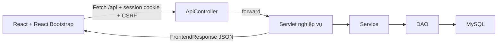

# Frontend chung: React + React Bootstrap

Cập nhật theo yêu cầu đổi toàn bộ frontend ngày 29/10/2026. Các trang giao diện đều được viết bằng React; Bootstrap CSS được đóng gói local. Không cần CDN hoặc một server Node riêng khi chạy WAR trên Tomcat.

## Công nghệ và cách chạy

- React 19.3.1, React DOM 19.3.1, React Bootstrap 2.10.10, Bootstrap 5.3.8.
- Vite build JS/CSS vào target/frontend. Maven đóng gói các asset và HTML shell vào hospital.war.
- Máy phát triển cần Node.js **22.12+** và npm trên PATH, bên cạnh JDK 17+, Maven, Tomcat/MySQL.
- `mvn clean package` tự chạy npm ci và npm run build trước khi đóng WAR. Bốn thành viên dùng chung package-lock.json; không commit node_modules.
- `./scripts/run-dev.ps1 -Port 3000` build rồi chạy Tomcat. Cấu hình DB giữ cách cũ qua DB_URL/DB_USER/DB_PASSWORD hoặc application-local.properties.
- Docker dùng stage Node 24 build frontend rồi stage Maven build Java; cuối cùng chạy một container Tomcat. Không cần Node/npm cài sẵn trên máy nếu chỉ dùng Docker.

Kiểm thử frontend:

```powershell
cd frontend
npm ci
npm test
```

Khi chỉ sửa Java hoặc chạy test backend, có thể dùng `mvn -Dfrontend.skip=true test`. Khi đóng WAR, chỉ dùng tùy chọn này nếu target/frontend đã được build và còn đúng phiên bản. Không dùng với clean package nếu chưa có bước build frontend riêng.

Phát triển giao diện với hot reload: chạy Tomcat cổng 3000, rồi `npm run dev` trong frontend và mở địa chỉ Vite in ra. API/download được proxy về Tomcat. Bản demo chính vẫn là http://localhost:3000/hospital.

## Phân công source cho 4 người

| Người | File trong frontend/src/pages | Chức năng |
|---|---|---|
| Khánh | KhanhPages.jsx | Đăng nhập, tìm bác sĩ/dịch vụ, đánh giá |
| Tráng | TrangPages.jsx | Đặt/đổi/hủy lịch, dịch vụ, hóa đơn/thanh toán |
| Kiên | KienPages.jsx | Tạo/đổi sức chứa/hủy ca, check-in/walk-in, hàng đợi/chuyển phòng |
| Nam | NamEmrPage.jsx, NamLabPages.jsx, NamRecordPages.jsx, NamReportPage.jsx | EMR, nhiều dòng thuốc, chỉ định, kết quả/tệp, thu hồi, hồ sơ bệnh nhân, báo cáo/xuất file |

App.jsx quản lý phiên, điều hướng, menu theo vai trò và thông báo bác sĩ. components.jsx chứa form, bảng, trạng thái và liên kết dùng chung. api.js chứa Fetch API và FormData. styles.css tùy chỉnh màu và bố cục trên Bootstrap; component tương tác dùng React Bootstrap, không dùng Bootstrap JS để thao tác DOM của React.

## Luồng dữ liệu



ApiController chuyển /api/emr đến EMRController, /api/appointments đến AppointmentController… Các Controller vẫn gọi đúng Service/DAO đã có. FrontendResponse biến các dữ liệu màn hình được cho phép thành JSON và loại bỏ password/hash/secret; không đưa dữ liệu nội bộ Servlet vào response.

Các thao tác POST gửi FormData hoặc application/x-www-form-urlencoded như hợp đồng cũ. Vì vậy vẫn giữ được mảng medicationId/quantity/dosage, danh sách serviceId và file multipart. Không thêm bản sao nghiệp vụ vào JavaScript.

- GET /api/login cấp CSRF; POST /api/login xác thực, đổi session và trả CSRF mới.
- GET /api/<chức năng> trả `{page,user,csrf,labels,data,error,flash}`.
- POST thành công trả `{redirect,user,csrf,labels}`; React điều hướng rồi đọc dữ liệu mới. Redirect ngoài hệ thống như VNPay được xử lý bằng điều hướng trình duyệt.
- Validation lỗi trả 422 và thông báo; form React giữ nguyên dữ liệu đang nhập.
- Phiên hết hạn trả 401; sai vai trò/CSRF trả 403; file quá lớn trả 413.
- SecurityFilter kiểm tra **đường dẫn chức năng sau /api**, không chỉ kiểm tra tiền tố /api. Service tiếp tục kiểm tra sở hữu bệnh án/tài khoản.
- Cookie HttpOnly do Tomcat quản lý. Không lưu mật khẩu/session token trong localStorage.
- Download PDF/Excel/tệp dùng các endpoint đã có, cùng cookie đăng nhập và quyền đọc.
- Bác sĩ nhận thông báo mỗi 15 giây; không reload form. Tab ẩn/không hoạt động tạm ngưng polling.

## Cập nhật báo cáo và sơ đồ

SRS/SDS hiện vẫn có mô tả View là JSP. Theo yêu cầu mới, nhóm cần đổi mô tả này sang **React + React Bootstrap**, Servlet trả JSON. Các file Google Docs/.vpp chưa được chỉnh tự động trong lần thay frontend này.

1. Software Architecture: Presentation là React; Browser gọi Servlet API bằng HTTP/JSON. Các lớp Filter, Controller, Service, DAO, Model và MySQL giữ vai trò nghiệp vụ.
2. Package Diagram: frontend là project riêng trong thư mục frontend; backend Java vẫn giữ các package hiện có. Không vẽ React thành package Java/JSP.
3. Sequence: boundary View thực thi bằng React; request qua API đến Controller, response là JSON. Nhánh validation quay lại form với thông báo lỗi. Các lời gọi Service/DAO, trạng thái, quyền và transaction giữ nguyên.
4. Class diagram/domain và ERD không đổi chỉ vì thay công nghệ giao diện. ApiController/FrontendResponse là phần giao tiếp HTTP; có thể đưa vào sơ đồ kiến trúc kỹ thuật.

Các giới hạn nghiệp vụ/tích hợp thật vẫn ở SCOPE.md; đổi frontend không đồng nghĩa đã hoàn tất toàn bộ SRS hoặc đã kết nối VNPay/SMTP/hệ thống dược thật.
